# Vampire Savior Recomp

An unofficial native PC port of the arcade game *Vampire Savior: The Lord of Vampire* (Capcom,
1997, CPS-2 board) for macOS, Linux (Steam Deck included) and Windows, made by static
recompilation, with a full training mode.

**[Get started: download it and play →](#playing)**

> **Beta.** The game plays from start to ending and its code is checked instruction by
> instruction, but it has been played on few machines and controllers yet. Expect rough edges, and
> please [report what you find](#feedback-and-contributing).

**No game files are included.** You need your own copy of the game: the arcade ROM set `vsavj`
(Japan, 970519) with its key file, from a board you own. **Only that version works**: the sets of
other regions and revisions (`vsav`, `vsavu`, `vsava`, `vsavh` and the rest) do not. This project
cannot help you get one.

This project is not affiliated with, endorsed by, or sponsored by Capcom. *Vampire Savior* and
*Darkstalkers* are trademarks of Capcom Co., Ltd.

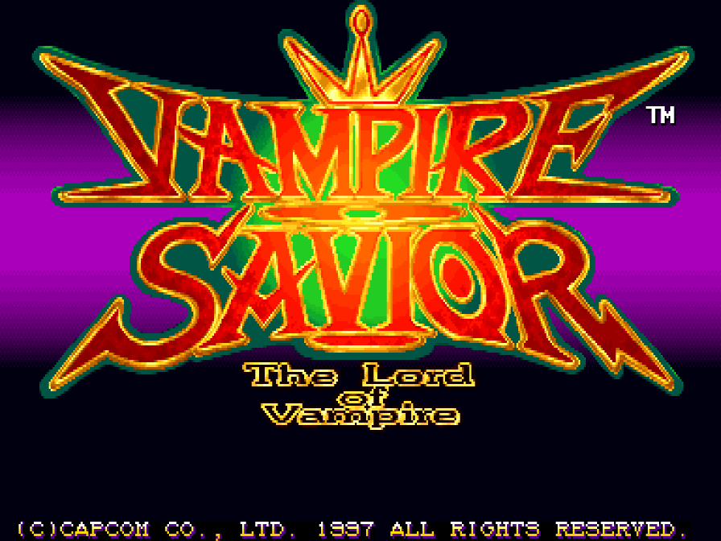

### New: dress the characters in your own colours

A colour editor in the game, with the character in front of you: any of their ten colour sets, 16
levels each of red, green and blue, random colours at the press of a button, and PalMod's colours
too. Then choose the character with that button and fight in them. [More, with a video
→](#custom-colours)

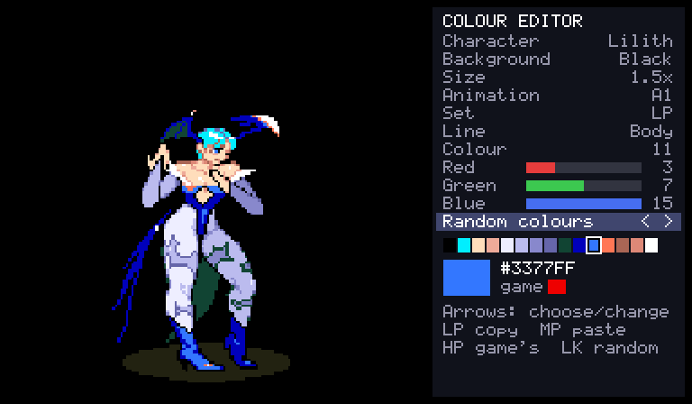

## What it is

The game's 68000 program is translated ahead of time into C++ and compiled into the port, and the
parts that features touch (the camera, the stages, hit tests, the fight's rules: 123 routines so
far) are rewritten by hand as readable C++. What the program expects of the board (its video, the
QSound chip, the sound CPU and its registers) is code written for this project, not an emulator
([how it works](docs/PORT.md)).

- Plays with a keyboard, a gamepad or an arcade stick; every key and button can be changed, for
  each player, in the launcher.
- An in-game menu (Esc or `F1`; on a gamepad, the left stick's click or Start and Select together)
  with the training mode and the other modes, save states, speed, the cheats and every feature.
- **Pure** plays exactly as the board does. **Enhanced** (the default) adds free play and your own
  [character colours](#custom-colours). Every other feature is a switch of its own.
- Your ROM set is only ever read. Settings, save states and the board's settings memory go in your
  own user folder.

| | |
| --- | --- |
| 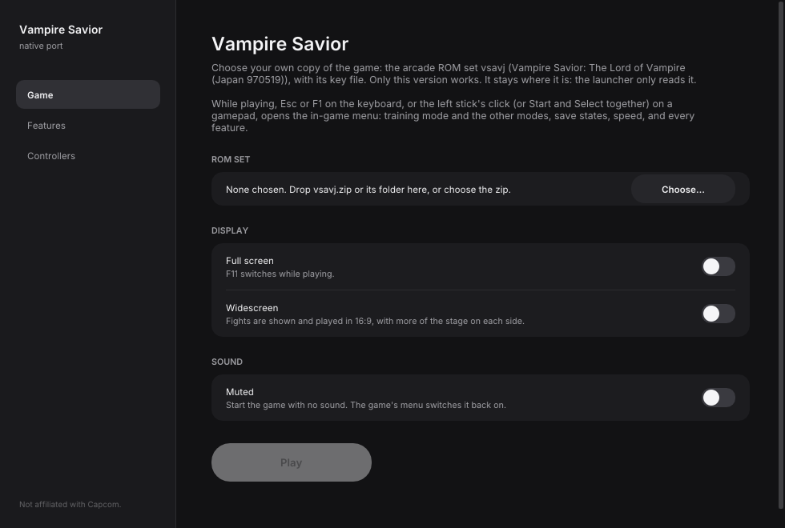 | 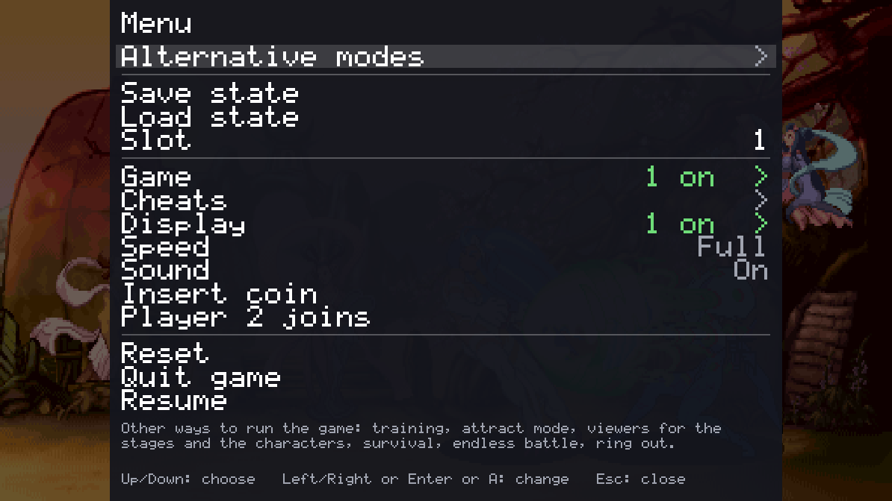 |
| 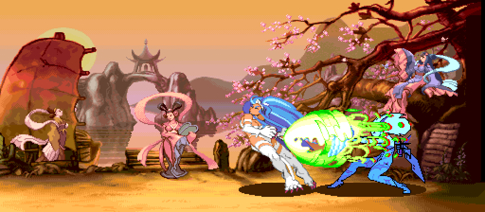 | 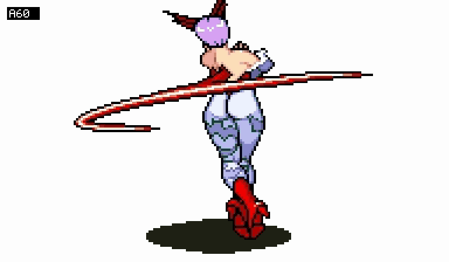 |

## Training mode

"Alternative modes" at the top of the in-game menu has a Training mode page: Start goes straight
to the character choice with two players and into a fight with no clock that nobody loses, and
the page holds the aids below.

| Feature | What it does |
| --- | --- |
| Hit boxes | The boxes the game itself tests: where a player can be hit (blue), attacks (red; orange for things thrown), and the boxes that keep the players apart (green) |
| Frame data and frame meter | Startup, active and recovery of each move and the advantage after a hit or a guarded hit, counted in the game's own steps; a row of coloured cells for each player, one a step |
| Input display | What each player presses and for how long, the stick as a keypad number |
| Combo readout | Hits, damage, how much is lost for good and how much comes back, the round's best |
| Health refills | A player's health comes back when they have not been hit for a moment |
| The dummy | Stands, crouches, jumps; guards (always, after a hit, at random; high or low as each attack needs); pushes away or guard cancels; softens throws; gets up where it fell or rolls towards or away; records and replays in three slots (one, or any at random), and can answer with a recording after guarding or being hit |
| Start over | The round as it began, in the middle or a corner, sides swapped or not (Backspace, or a gamepad's left shoulder) |
| Stage | Any of the twelve stages, or the game's own choice |
| Stop, step, slow | Stop the game, go on one frame at a time, or play at a half, a quarter or an eighth of the speed (anywhere, not only in training) |

Also: save states in nine slots, free play, and a few cheats (no damage, one-hit knockouts, full
gauge, infinite time). [docs/FEATURES.md](docs/FEATURES.md) has the whole list.


## Alternative modes

The in-game menu's first row, "Alternative modes", has ways of playing and watching the game that
the board does not have. Each has a page with a Start row and its own choices, and runs until
another is started or the menu's Reset.

| Mode | What it does |
| --- | --- |
| Training mode | A fight with no clock that nobody loses, and the aids above |
| Attract mode | The game's own show on a loop, as a cabinet left alone plays it, with no coin to keep out: everything, the introduction only, or its eight demonstration fights one after another |
| Stage viewer | Any of the twelve stages with nobody on it and no panel, its own pieces moving and its music playing (or another stage's). Scroll it with the stick, or let it drift from end to end. "Infinite" is all twelve in turn, each scrolling into the next as its tune fades into the next one's |
| Model viewer | One character by itself, on a stage or on plain white or black, from a quarter of its size to 25 times. It stands and moves with your controls, or goes through any of its animations (named A0, B12, C3... as the game's own lists number them; left and right step through them), at full speed or in slow motion. At its own size, what the stage has in front of the fighters stays in front (or, with "Stage in front" off, behind it) |
| Survival | One opponent after another on the health you have left. How many can you beat? |
| Endless battle | Two fighters the game plays, for as long as you like, with no bars and no clock, on one stage, on stages that fade one into another, or on a floor that scrolls through them all. Touch the controls to take a fighter over |
| Ring out | No health. Knock your opponent over the end of the stage and jump down to the next one |
| Colour editor | Change a character's colours while you watch: [custom colours](#custom-colours) |


## Widescreen

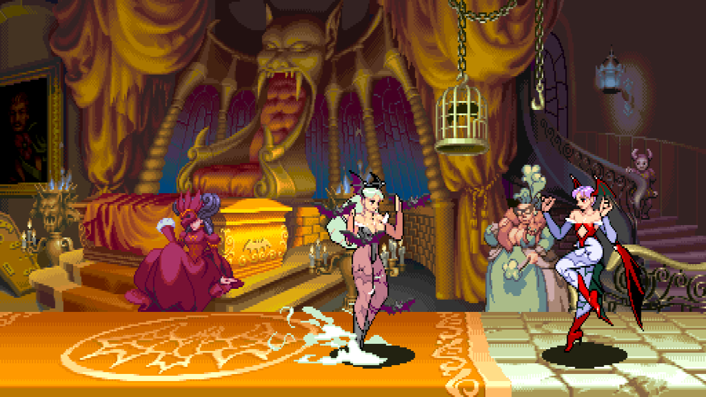

A switch on the launcher's first page, under "Full screen" (and on the in-game menu's Display
page). Fights are shown and played in 16:9: the picture is 512 columns wide where the board's is
384, at the same height and with everything the same size, so there is a third more of the stage
in view.

It is **off unless you switch it on**, in every preset, because it changes how the game plays:

- The players can go to the wide picture's edges, so they can stand further apart than on the
  board (464 at most, where the board allows 336). The stage's own ends are where they were.
- The camera stops 64 short of where it did, so that the picture ends where the stage does.
- A stage's own pieces and things thrown are kept while they are in the wide picture, not only
  the board's. (Some pieces still come in a little late at the wide picture's edge, and at the
  very ends of a stage a few columns of the planes behind are not painted: see the roadmap.)
- The bars, the clock and the gauges stay in the middle. Survival, the endless battle, the ring
  out and the stage viewer are wide too. Everything that is not a fight keeps the board's 4:3.

With it off the game is exactly the board's. Nothing here stretches the picture: the extra
columns are the game's own stage, drawn by the port from what the game already has.

## Custom colours

Give any character colours of your own: change them in the game's colour editor, or bring the ones
you have made with PalMod.

https://github.com/user-attachments/assets/bb498cab-aac9-4e74-94a5-6c4f0d958ff6

| | |
| --- | --- |
| 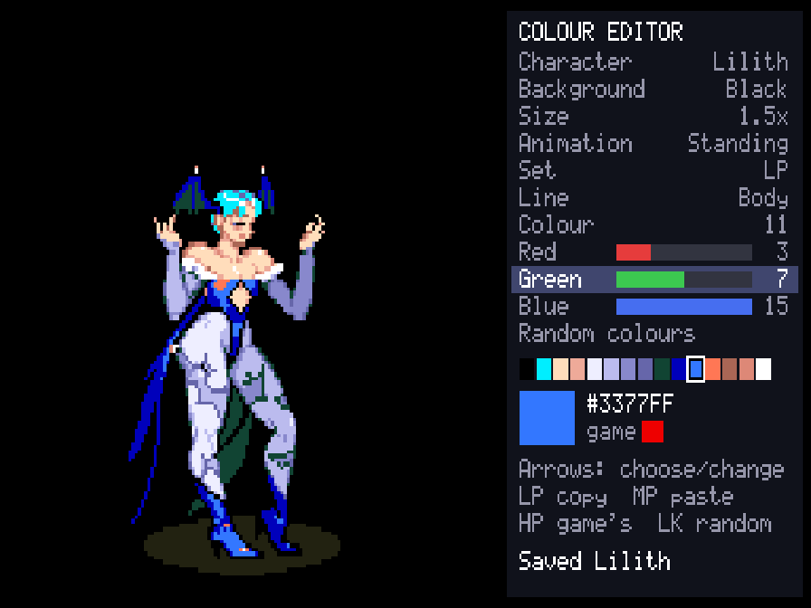 | 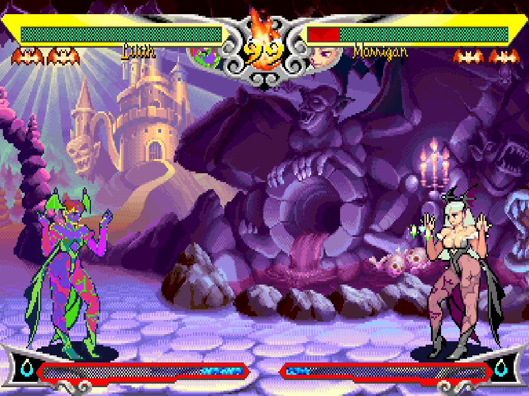 |

Morrigan in eighteen sets of colours made with the editor:

| | |
| --- | --- |
| 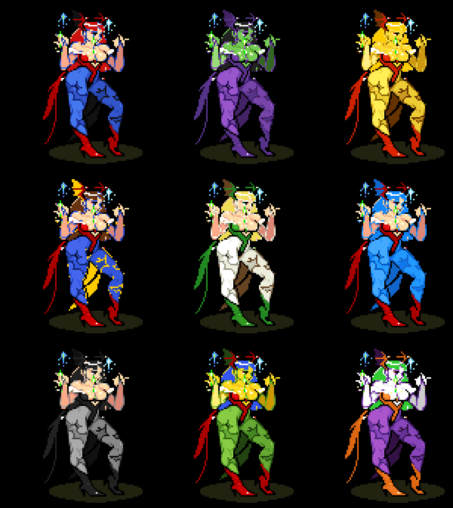 | 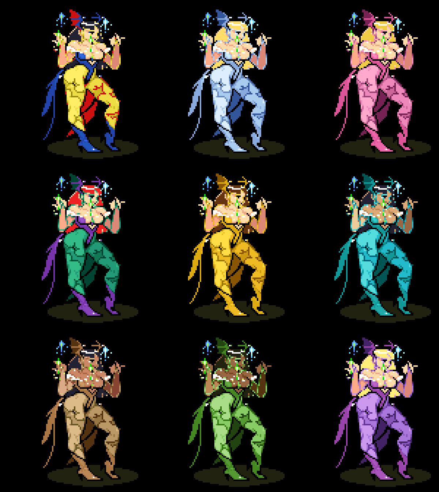 |

**The colour editor** is on the in-game menu's "Alternative modes" page. It shows the character
with a panel at the right, worked with player 1's controls: up and down choose a row, left and right
change it.

- **Character, background, size, animation**: who you are dressing, on what, how large, standing
  or going through one of their animations.
- **Set**: which of the character's ten colour sets, by how it is chosen at the character choice:
  LP, MP, HP, LK, MK, HK, two punches together (PP), two kicks together (KK), and the two used with
  auto guard.
- **Line**: the character's own colours, or one of three lines for their effects. Choosing a line
  shows the animation that uses it most, for the characters that keep all four lines on show
  (Bulleta, Victor, Morrigan, Anakaris and Q-Bee; it is found in the first few seconds the
  editor shows a character). The others' extra lines are seen only when an effect needs them.
- **Colour, Red, Green, Blue**: one of the line's 15 colours (it blinks on the character when you
  choose it), and its red, green and blue in the board's 16 levels each.
- **Random colours**: every colour of the set at random, at a second press on its row (LK, left
  or right, twice), so that one press by mistake loses nothing. HK puts back the colours from
  before the random ones, until the next change.
- **Save set** and **Load**: keep a set you like in the character's library and put it back later,
  into this set or any other (a design made on LP can go on KK). Left and right on Load try each
  saved one on the character; LP loads it, MK twice deletes it, and moving off the row without
  loading puts your colours back.
- LP copies a colour, MP pastes it, HP gives back the game's; the menu page puts back the game's
  colours for the whole set or the whole character.

Changes show at once and are saved as you go. **To play in them, choose the character with the
button of the set you changed** (Lilith with LP, say), anywhere: arcade, versus, training.

**Files.** What you change goes in a `palettes` folder beside `settings.ini`, a text file a
character (`Lilith.txt`) holding only the sets that are not the game's. The folder is:

| System | Folder |
| --- | --- |
| Windows | `%APPDATA%\Vampire Savior\palettes` (paste it into Explorer's address bar; it is the `AppData\Roaming` folder in your user folder) |
| macOS | `~/Library/Application Support/Vampire Savior/palettes` |
| Linux, SteamOS | `~/.local/share/Vampire Savior/palettes` |

You can write or share them by hand: "Write the game's colours" (on the colour editor's page of
the menu) puts every character's own colours in `palettes/original` to
start from, and [docs/FEATURES.md](docs/FEATURES.md) has the format. Saved sets are files too, one a
set, in `palettes/library/<Character>/` (`Lilith 1.txt`, `Lilith 2.txt`...): to share a design, share
its file, and to use one someone gave you, put it in that folder.

**PalMod.** Colours made with [PalMod](https://github.com/Preppy/PalMod), the community's palette
editor, work too: edit a copy of your set's `vm3j.10b` with it (never the one in your ROM set) and
put the copy in `palettes`. The characters' colours it changed are used, their effects' too
(poisoned, burned and the like); anything else in that file is left as the game's, so it cannot
change how the game plays. Text files go over it.

"Load colour files again", on the same page, reads files you changed while the game runs.
"Custom colours" on the Display page switches all of it: on in Enhanced (it changes nothing until
there are files), off in Pure.

## What you need

- The ROM set `vsavj` (*Vampire Savior: The Lord of Vampire*, Japan 970519): `vsavj.zip` (with
  `vsav.zip` beside it if your collection keeps the shared files there) or a folder with the set's
  files, including `vsavj.key`. The launcher checks every file by checksum and tells you which is
  missing or different. Sets of other regions and revisions are refused: the port is made from this
  one version's program, and its training features use addresses found in it.
- One of: macOS 13 or later (Apple silicon or Intel); Linux x86_64 or SteamOS; Windows 10 or 11,
  64-bit.
- A gamepad or stick with six buttons is recommended.

## Playing

1. Download the build for your system from the [releases page](../../releases) and unpack it.
2. Open the launcher (`Vampire Savior Recomp.app`, `vampire_savior-launcher`) and drop your ROM set on it,
   or choose it. It stays where it is.
3. Press **Play**.

While playing, Esc or `F1` (on a gamepad, the left stick's click, or Start and Select together)
opens the in-game menu. The launcher's Controllers page changes any key or button, for each
player, and lists the other keys. Only the menu's "Quit game" row (or closing the window) ends
the game.

macOS: the app is not notarized, so the first time, right-click it and choose Open.
Linux: unpack the archive anywhere and run `vampire_savior-launcher`.
Windows: run `vampire_savior-launcher.exe`. Opening `vampire_savior.exe` by itself starts the
launcher too (straight into the game once a ROM set has been chosen).

### Steam Deck

1. Hold the power button and choose **Switch to Desktop**.
2. Download `VampireSavior-linux-x86_64.tar.gz` from the [releases page](../../releases). In the
   file manager (Dolphin), right-click it and choose **Extract → Extract archive here**, then move
   the `VampireSavior` folder where it can stay (for example a new `Applications` folder in your
   home folder). If you move it later, do step 5 again.
3. Copy your ROM set (`vsavj.zip` with its key file, or its folder) onto the Deck, for example from
   a USB stick or the SD card.
4. In the `VampireSavior` folder, open `vampire_savior-launcher` and choose your ROM set (or drop
   it on the window).
5. On the launcher's Game page, press **Add to Steam**. It adds two entries to your library:
   **Vampire Savior** (straight into the game) and **Vampire Savior Launcher** (the ROM set,
   features and controls).
6. Go back to Gaming Mode with the **Return to Gaming Mode** icon on the desktop. Both are in your
   Library under **Non-Steam**.

In the game, click the left stick, or press View and Menu together (the two buttons either side
of the screen's top), to open the in-game menu; its "Quit game" row ends the game.

## Building from source

With your own ROM set in `rom/` (ignored by Git), CMake, Ninja, SDL 3 and Python 3:

```sh
make            # twice the first time
make explore    # once, about ten minutes: finds the game's code by made-up play and translates it
make run
```

[docs/BUILDING.md](docs/BUILDING.md) has every platform, the checks and the release builds.

## Feedback and contributing

Bug reports and pull requests are welcome: see [CONTRIBUTING.md](CONTRIBUTING.md) for the rules
(above all: nothing from the game, ever) and [docs/ROADMAP.md](docs/ROADMAP.md) for what is next.

## License and credits

GPL-3.0-only (see [LICENSE](LICENSE)). [THIRD_PARTY_NOTICES.md](THIRD_PARTY_NOTICES.md) lists what comes
from other projects: the CPS-2 program cipher is MAME's (BSD-3-Clause; worked out by Andreas Naive
and Nicola Salmoria), the QSound model follows MAME's high-level one (superctr, Valley Bell), the
hardware facts follow MAME's CPS-2 driver, and the launcher's look comes from arelkair's
wiiparty-recomp. SDL 3, Dear ImGui and the Inter font are used by the programs.

The repository holds no game data and nothing derived from it.
